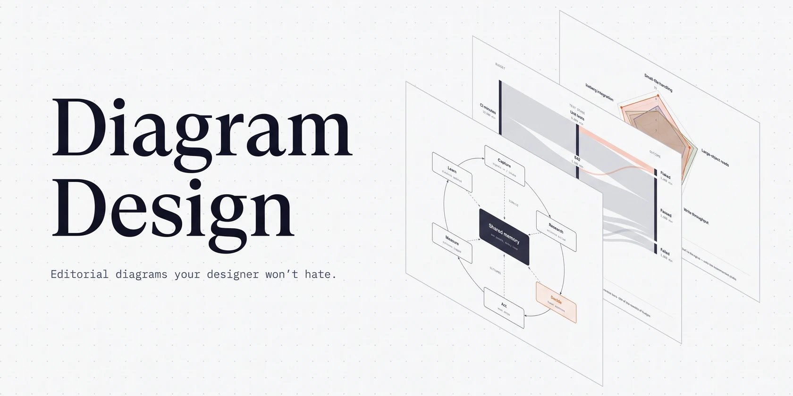

# Diagram Design 📐 — Diagramas Técnicos e Editoriais de Alta Qualidade

<p align="center">
  
</p>

<p align="center">
  <em>Diagramas editoriais de alto padrão que seus designers vão elogiar.</em><br>
  <strong>45 tipos de diagramas visuais em arquivos autocontidos HTML + SVG inline, no padrão da sua marca. Sem sombras pesadas. Sem o clichê do Mermaid.</strong>
</p>

<p align="center">
  
  
  
  
</p>

---

## 💡 Sobre o Diagram Design

A maioria das ferramentas de IA gera diagramas genéricos em Mermaid ou blocos monocromáticos cheios de caixas e linhas cruzadas que ninguém consegue ler em reuniões técnicas ou documentos de arquitetura.

O **Diagram Design** revoluciona a criação de diagramas para agentes de IA:
- **Arquivo Único HTML + SVG**: Gera um único arquivo `.html` legível e autocontido com vetor SVG inline. Funciona instantaneamente ao clicar duas vezes, sem precisar de servidores locais ou ferramentas adicionais.
- **Filosofia Editorial Minimalista**: A ação de maior qualidade é a deleção. Densidade ideal de 4/10, sem excesso de linhas desnecessárias, com foco editorial (máximo 1 a 2 nós em destaque com cor focal).
- **Alinhamento com a Sua Marca**: O agente pode analisar o site do seu produto ou sistema de design e adotar automaticamente a mesma paleta de cores e tipografia.
- **Compatibilidade e Importação**: Importa diagramas existentes do **Mermaid**, **Draw.io** e **Excalidraw**, redesenhando-os no novo padrão editorial.

Empacotado e disponibilizado para o [marcelo-plugins](https://github.com/marcelocaldasdevops/marcelo-plugins) por [Marcelo Caldas](https://github.com/marcelocaldasdevops), baseado no projeto oficial de [Cathryn Lavery](https://github.com/cathrynlavery/diagram-design).

---

## 📊 Os 45 Tipos de Diagrama Suportados

Peça ao agente em linguagem natural e ele escolherá a melhor representação visual:

### 1. Arquitetura e Engenharia de Software
- **`architecture`**: Arquitetura de aplicações (frontend, microserviços, filas, bancos de dados e caches).
- **`architecture-delta`**: Destaca o que é novo, modificado ou descontinuado em migrações técnicas e RFCs.
- **`deployment`**: Topologia de infraestrutura em nuvem, nós Kubernetes e redes.
- **`dependency`**: Grafo acíclico de dependências entre módulos e pacotes.
- **`layers`**: Pilhas de abstração em camadas de software ou protocolos.
- **`medallion`**: Arquitetura de dados moderna Lakehouse (Bronze -> Silver -> Gold).
- **`data-flow`**: Rastreamento de fluxo de dados de ponta a ponta com transformações.
- **`it-state`**: Mapeamento do estado atual de TI corporativa.

### 2. Processos, Fluxos e Tempo
- **`flowchart`**: Fluxogramas clássicos de decisão com ramificações elegantes.
- **`sequence`**: Diagramas de sequência para chamadas de API, autenticação e fluxos com lifelines.
- **`state`**: Máquinas de estados finitos com transições, gatilhos e guardas.
- **`timeline`**: Marcos temporais e roadmaps sequenciais.
- **`swimlane`**: Processos distribuídos por papéis, equipes ou sistemas em raias organizadas.
- **`sankey`**: Fluxos proporcionais de volume, tráfego ou custos.

### 3. Estratégia, Negócios e Produto
- **`quadrant`**: Matriz 2x2 para priorização de backlog e decisões de produto (Impacto vs Esforço).
- **`wardley`**: Mapas de Wardley para análise estratégica de maturidade e valor.
- **`radar` / `polar`**: Gráficos de radar/aranha para comparação multidimensional de capacidades.
- **`kanban`**: Quadros de fluxo de entrega com limites de trabalho em progresso (WIP).
- **`journey`**: Jornada do usuário com estágios, pontos de contato e níveis de fricção.
- **`service-blueprint`**: Integração entre frontstage (cliente) e backstage operacional.

### 4. Modelagem e Estrutura de Dados
- **`er`**: Modelagem conceitual Entidade-Relacionamento.
- **`db-schema`**: Esquema relacional com tabelas, chaves primárias, estrangeiras e tipos.
- **`uml-class`**: Diagramas de classes orientados a objetos com métodos, atributos e herança.
- **`tree` / `org-chart`**: Árvores de decomposição e organogramas organizacionais.
- **`venn` / `nested`**: Conjuntos de inclusão e diagramas de Venn.

### 5. Gráficos Técnicos e Estatísticos
- **`bar`**, **`waterfall`**, **`heatmap`**, **`treemap`**, **`scatter`**, **`gantt`**, **`line`** (slopegraph, streamgraph, ridgeline, bump).

---

## ⚡ Comandos Slash Disponíveis

| Comando | Descrição |
| :--- | :--- |
| **`/diagram-design <prompt>`** | Cria um novo diagrama a partir de uma descrição textual. |
| **`/import-mermaid <arquivo>`** | Importa um diagrama Mermaid (`.mmd` ou markdown) e redesenha no padrão editorial. |
| **`/import-drawio <arquivo>`** | Importa e converte arquivos do Draw.io (`.drawio` ou `.xml`). |
| **`/import-excalidraw <arquivo>`** | Converte rascunhos do Excalidraw (`.excalidraw`). |
| **`/export-diagram <arquivo.html>`** | Exporta o diagrama HTML para arquivos `.svg` e `.png` de alta definição. |
| **`/profile`** | Gerencia perfis de marca e paletas personalizadas para reutilização. |
| **`/doctor`** | Executa diagnósticos de ambiente para verificar ferramentas de renderização e exportação. |

---

## 🎨 Como Alinhar com a Sua Marca

Basta solicitar ao agente:
> *"Configure o diagram-design com o estilo de https://meusite.com"*

O agente inspeciona as cores principais e a tipografia da sua página web e aplica os tokens nas variáveis do diagrama, garantindo que todas as saídas futuras combinem com a identidade visual da sua empresa.

---

## 🚀 Como Instalar

### 1. Google Antigravity CLI (`agy`)
```bash
# Validar o plugin
agy plugin validate plugins/diagram-design

# Instalar localmente
agy plugin install plugins/diagram-design

# Listar plugins instalados
agy plugin list
```

### 2. Claude Code
```text
/plugin install diagram-design@marcelo-plugins
```

### 3. Cursor e Bithub
Ative o plugin na interface do marketplace de extensões ou selecione `diagram-design` na aba de plugins.

### 4. Codex / OpenCode / Cline / Roo Code
Aponte o carregador para `rules/AGENTS.md` e a pasta `skills/diagram-design/`.

---

## 📄 Licença

Distribuído sob a licença MIT. Criado por [Cathryn Lavery](https://github.com/cathrynlavery/diagram-design) e mantido no marketplace por [Marcelo Caldas](https://github.com/marcelocaldasdevops).
