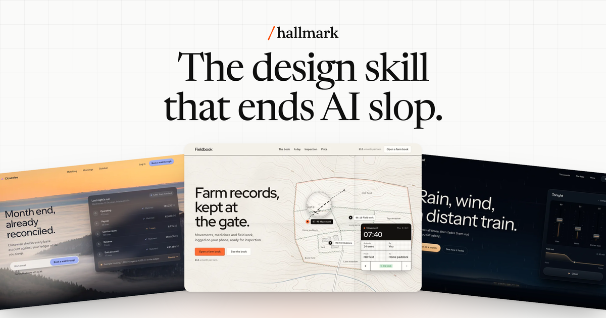

# Hallmark 🎨 — Design Profissional Anti-AI-Slop

<p align="center">
  
</p>

<p align="center">
  <em>A skill de design para agentes de IA que se recusa a parecer gerada por inteligência artificial.</em><br>
  <strong>Adeus ao "AI Slop": interfaces com acabamento de estúdio humano, tipografia refinada e tokens semânticos.</strong>
</p>

<p align="center">
  
  
  
  
</p>

---

## 💡 Sobre o Hallmark

Modelos de linguagem treinados em massa tendem a convergir para os mesmos vícios visuais: gradientes roxos genéricos, cartões dentro de cartões, pequenos rótulos em caixa alta espaçada ("eyebrows") em cima de cada título, depoimentos falsos com fotos genéricas e janelas de browser desenhadas à mão.

O **Hallmark** estabelece um **Piso Inviolável (The Floor)** contra esses defeitos, escolhe direções visuais autênticas a partir de um catálogo de **48 materiais e temas de design**, constrói a página ao redor do que o visitante realmente veio fazer e valida o resultado com um linter automatizado (`sloplint.mjs`) em um navegador real.

Empacotado e disponibilizado para o [marcelo-plugins](https://github.com/marcelocaldasdevops/marcelo-plugins) por [Marcelo Caldas](https://github.com/marcelocaldasdevops), baseado no projeto oficial de [Nutlope](https://github.com/Nutlope/hallmark) e powered by **Together AI**.

---

## 🏛️ O Piso Inviolável (The Floor)

Regras rígidas aplicadas em toda criação ou refatoração:

| # | Regra | Por que importa |
| :--- | :--- | :--- |
| **1** | **Tokens em `:root`** | Toda cor (OKLCH) e fonte deve usar variáveis CSS no topo. Sem cores literais espalhadas. |
| **2** | **Sem `transition: all`** | Nunca animar `width`, `height`, `top` ou `left`. Animações apenas em `transform` e `opacity`. |
| **3** | **Sem Itálico Solto** | Proibido destacar uma única palavra com itálico no meio de títulos roman. |
| **4** | **`overflow-x: clip`** | No `html` e `body`. Elimina scrollbars horizontais fantasmas (nunca use `100vw`). |
| **5** | **Grids com `minmax(0, 1fr)`** | Evita que imagens ou código estourem colunas CSS Grid. |
| **6** | **Foco Visível (`:focus-visible`)** | Acessibilidade mandatória em todos os botões, links e campos. |
| **7** | **Movimento Reduzido** | Suporte obrigatório a `@media (prefers-reduced-motion: reduce)`. |
| **8** | **Sem Dados Falsos de IA** | Sem depoimentos fictícios de "CEOs", métricas inventadas ou logos falsos. |
| **9** | **Sem Eyebrows Clichês** | Sem rótulos em caixa alta espaçada acima dos títulos. Rótulos usam a fonte do corpo em caixa baixa ou normal. |
| **10** | **Sem Gradiente Roxo-Azul** | Elimina a paleta genérica de templates de IA, adotando materiais com identidade autêntica. |
| **11** | **Hero Visível a 1280x800** | Título, frase de impacto e botão principal cabem confortavelmente sem precisar rolar. |
| **12** | **Densidade Consciente** | Cerca de 80 palavras por bloco de tela, priorizando respiração e foco na ação do usuário. |

---

## 🎨 Catálogo de 48 Temas e Materiais

Um tema no Hallmark é um **material**, não um molde engessado: define tipografia, contraste, superfícies, texturas e componentes sem forçar uma ordem pré-definida de seções.

Alguns dos temas de destaque inclusos com referências visuais em [`references/themes/`](skills/hallmark/references/themes/):
- **Dusk**: Visual escuro sofisticado e sereno (ideal para finanças, conciliação e segurança).
- **Cobalt**: Engenharia limpa e técnica (ideal para APIs, webhooks e ferramentas de desenvolvimento).
- **Studio**: Editorial refinado e contemporâneo (agências de design, branding e arquitetura).
- **Atelier**: Luxuoso, clássico e sensorial (perfumarias, moda e produtos artesanais).
- **Ribbon**: Tons suaves e acolhedores (bem-estar, saúde e aplicativos de áudio).
- **Terminal**: Inspiração retrô-moderna em linha de comando e dotfiles.
- **Furrow**: Texturas orgânicas e terrosas (agronegócio, campo e sustentabilidade).

---

## ⚡ Comandos e Modos de Uso

| Comando | Descrição |
| :--- | :--- |
| **`/hallmark [prompt]`** | Cria uma nova página ou interface do zero aplicando um tema curado ou visual customizado sob medida. |
| **`/hallmark-redesign <caminho>`** | Redesenha uma página existente elevando o design ao padrão humano, mantendo 100% dos textos reais e formulários. |
| **`/hallmark-audit <caminho>`** | Realiza uma auditoria minuciosa de design anti-AI-slop contra o Piso Inviolável sem modificar o código. |

---

## 🔍 Linter Integrado (`sloplint.mjs`)

O plugin inclui o script de validação visual [`skills/hallmark/scripts/sloplint.mjs`](skills/hallmark/scripts/sloplint.mjs) que pode ser executado via Node.js para inspecionar saídas renderizadas contra contraste, overflow, estados de foco e clichês de IA:

```bash
node skills/hallmark/scripts/sloplint.mjs index.html --render
```

---

## 🚀 Como Instalar

### 1. Google Antigravity CLI (`agy`)
```bash
# Validar o plugin
agy plugin validate plugins/hallmark

# Instalar localmente
agy plugin install plugins/hallmark

# Listar plugins instalados
agy plugin list
```

### 2. Claude Code
```text
/plugin install hallmark@marcelo-plugins
```

### 3. Cursor e Bithub
Adicione o repositório `marcelo-plugins` no marketplace de plugins ou selecione `hallmark` na aba de plugins disponíveis.

### 4. Codex / OpenCode / Cline / Roo Code
Basta apontar o carregador de regras para `rules/AGENTS.md` e a pasta `skills/hallmark/`.

---

## 📄 Licença

Distribuído sob a licença MIT. Criado por Nutlope e Together AI, mantido no marketplace por Marcelo Caldas.
