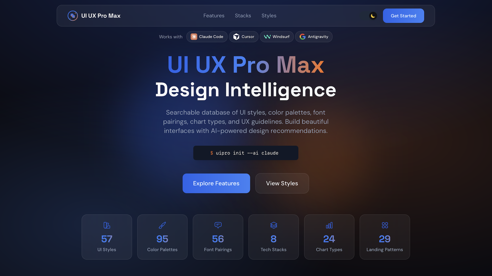

# UI/UX Pro Max 🎨 — Inteligência de Design UI/UX, Design Systems e Acessibilidade

<p align="center">
  
</p>

<p align="center">
  <em>Inteligência avançada de UI/UX, design systems e auditoria de acessibilidade para agentes de IA.</em><br>
  <strong>79 estilos de interface (50 ativos), 192 paletas de cores calibradas, 74 combinações de fontes do Google Fonts, 119 diretrizes de UX e padrões para 22 frameworks. Sem templates genéricos de IA.</strong>
</p>

<p align="center">
  
  
  
  
  
  
</p>

---

## 💡 Sobre o UI/UX Pro Max

A maioria dos modelos de IA comete os mesmos erros repetitivos ao gerar interfaces: gradientes roxos e azuis neon genéricos, textos cinza-claros sem contraste legível (reprovados na WCAG), falta de feedback de clique (`cursor-pointer`), ausência de foco acessível e layouts quebrados em telas menores.

O **UI/UX Pro Max** soluciona isso transformando o agente em um arquiteto sênior de produto:
- **Motor de Busca e Raciocínio Local (Zero Dependências Externas)**: Executa um script Python embutido de altíssima performance para consultar um banco de dados local com 79 estilos, 192 paletas semânticas por nicho, 74 combinações de tipografia e regras de UX.
- **Gerador Automático de Design Systems**: Gera com precisão matemática tokens em três camadas (primitivo → semântico → componente), escalas de espaçamento (ritmo de 8dp), contraste auditado e lista de anti-patterns específicos para a sua indústria.
- **Auditoria em 7 Fases de Front-end**: Antes de marcar o trabalho como concluído, audita acessibilidade (WCAG 2.1 AA), contraste de superfícies, estados completos (`hover`, `active`, `disabled`, `loading`) e responsividade em múltiplos viewports (375px a 1440px+).

Empacotado e disponibilizado para o [marcelo-plugins](https://github.com/marcelocaldasdevops/marcelo-plugins) por [Marcelo Caldas](https://github.com/marcelocaldasdevops), baseado no projeto oficial de [NextLevelBuilder](https://github.com/nextlevelbuilder/ui-ux-pro-max-skill).

---

## 🛠️ As 7 Skills Integradas

O plugin reúne uma suíte completa de 7 skills de design especializadas:

1. **`ui-ux-pro-max` (Skill Central)**:
   - Inteligência central de design para web, mobile e desktop.
   - Motor de busca `search.py` para consultar estilos, paletas, gráficos, diretrizes e stacks.
   - Geração de sistemas de design completos (`--design-system`).
2. **`ui-styling`**:
   - Componentes acessíveis com **shadcn/ui** (Radix UI) e estilização utilitária com **Tailwind CSS**.
   - Design visual em canvas e renderização de layouts tipográficos com fontes personalizadas.
3. **`design-system`**:
   - Arquitetura de tokens em 3 camadas (primitivo → semântico → componente).
   - Variáveis CSS nativas, especificações de componentes e geração de documentação de design.
4. **`brand`**:
   - Definição de tom de voz (*brand voice*), identidade visual, diretrizes de consistência e gestão de ativos de marca.
5. **`banner-design`**:
   - Criação de banners criativos multiformato para redes sociais (LinkedIn, Twitter/X, Instagram, YouTube), Google Ads, seções hero e materiais de divulgação em 22 estilos visuais.
6. **`slides`**:
   - Apresentações estratégicas e pitch decks interativos em HTML autocontido com visualização de dados via **Chart.js**.
7. **`design`**:
   - Meta-habilidade unificada que orquestra identidade de marca, tokens, logotipos, apresentações e banners em um único fluxo de trabalho.

---

## 💻 Suporte Completo a 22 Stacks de Tecnologia

O banco de dados fornece regras, componentes e padrões idiomáticos para:

| Ecossistema | Tecnologias Suportadas |
| :--- | :--- |
| **Web Moderno / React** | React, Next.js (App Router / Pages), Astro, Three.js |
| **Vue & Ecossistema** | Vue 3, Nuxt.js, Nuxt UI |
| **Componentes & CSS** | Tailwind CSS, shadcn/ui, HTML5 semântico |
| **Mobile Nativo & Híbrido** | SwiftUI (iOS), Jetpack Compose (Android), React Native, Flutter |
| **Frameworks Leves & SSR** | Svelte / SvelteKit, Laravel / Blade |
| **Enterprise / Desktop** | JavaFX, WPF, WinUI, Avalonia, Uno Platform, UWP |

---

## ⚡ Comandos Slash Disponíveis

| Comando | Descrição |
| :--- | :--- |
| `/ui-ux-pro-max [termo]` | Consulta geral de inteligência de design e recomendações para o produto. |
| `/design-system <projeto>` | Gera a especificação estruturada do Design System com tokens, cores, fontes e UX. |
| `/design-plan <contexto>` | Elabora o plano visual, tokens e assinatura distintiva antes de iniciar o código. |
| `/design-review [url-ou-arquivo]` | Executa auditoria em 7 fases de acessibilidade (WCAG AA), contraste e layout. |
| `/search-style <termo>` | Pesquisa na base de 79 estilos visuais (Bento Grid, Neumorfismo Suave, Minimalismo, etc.). |
| `/search-palette <nicho/humor>` | Pesquisa na base de 192 paletas de cores semânticas calibradas. |
| `/search-font <tom>` | Pesquisa combinações tipográficas do Google Fonts com links prontos de importação. |
| `/search-stack <stack> [termo]` | Consulta padrões de código e diretrizes específicas para uma das 22 stacks. |

---

## 🧪 Auditoria em 7 Fases de Front-end

Ao utilizar `/design-review` ou o agente `design-review`, o sistema audita:

```
┌─────────────────────────────────────────────────────────────────┐
│ 1. Setup & Baseline       → Inspeciona console e montagem       │
│ 2. Interação & Estados    → Hover, active, disabled, cursor     │
│ 3. Acessibilidade (WCAG)  → Contraste >=4.5:1, foco por teclado │
│ 4. Responsividade         → 375px (mobile) a 1440px (desktop)   │
│ 5. Tipografia & Hierarquia→ Legibilidade, line-height, fontes   │
│ 6. Cores & Modo Escuro    → Paridade visual e bordas legíveis   │
│ 7. Animação & Movimento   → Duração 150-300ms, reduced-motion   │
└─────────────────────────────────────────────────────────────────┘
```

---

## 🚀 Como Instalar e Usar

### No Antigravity CLI (`agy`)

Instale o plugin diretamente a partir do repositório local:
```bash
agy plugin install plugins/ui-ux-pro-max
```

Ou execute comandos diretamente no chat:
```text
/design-system FinFlow "fintech dashboard trustworthy data-dense"
```

### No Claude Code, Cursor e Bithub

O plugin é detectado automaticamente através dos manifestos padronizados:
- **Claude Code**: Carrega as skills em `skills/` e as regras em `rules/AGENTS.md`.
- **Cursor / Composer**: Lê os metadados de `.cursor-plugin/` e aplica as regras automaticamente.
- **Bithub**: Disponível no catálogo de extensões do marketplace sincronizado.

---

## 📄 Licença

Distribuído sob a licença **MIT**. Veja o arquivo `LICENSE` para mais detalhes.
